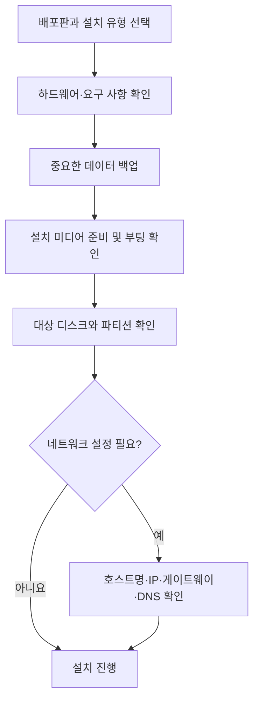

# 리눅스 설치 준비와 유형

## 1. 배포판과 설치 미디어

리눅스는 다양한 배포판으로 제공된다. 배포판은 커널과 시스템 도구, 패키지 관리 방식, 설치 프로그램 등이 다를 수 있으므로 설치 방법과 요구 사항도 배포판별로 확인해야 한다.

- 설치 이미지는 배포판의 공식 웹사이트나 공식 미러에서 내려받는다.

- 설치 이미지는 USB 메모리, DVD 등의 부팅 미디어에 기록해 설치에 사용할 수 있다.

- 내려받은 파일의 체크섬 또는 전자 서명을 확인하면 파일의 손상이나 위변조 여부를 점검하는 데 도움이 된다.

## 2. 설치 유형

설치 유형은 목적에 맞는 소프트웨어와 시스템 구성을 선택하는 방식이다. 유형의 명칭과 제공 여부는 배포판 및 버전에 따라 달라진다.

| 유형 | 주요 목적 |
|---|---|
| 최소 설치 (Minimal) | 필수 구성 요소 위주로 설치해 자원 사용과 설치 패키지를 줄인다. |
| 데스크톱/워크스테이션 | 그래픽 환경과 일반 사용자용 응용 프로그램을 포함해 개인용 컴퓨터나 개발용 시스템에 적합하다. |
| 서버 | 서버 역할에 필요한 소프트웨어를 중심으로 설치한다. 그래픽 환경을 포함할지는 구성에 따라 다르다. |
| 랩탑 | 노트북의 전원 관리와 무선 네트워크 등 이동형 시스템에 필요한 구성을 고려한다. |
| 가상화 호스트 | 가상 머신을 실행하고 관리하는 데 필요한 가상화 소프트웨어를 포함한다. |

> 설치 유형을 선택했다고 해서 디스크의 모든 파티션이 자동으로 삭제되는 것은 아니다. 파티션 삭제나 디스크 초기화 여부는 설치 프로그램의 디스크 구성 선택과 사용자 확인에 따라 달라지므로 설치 전 대상 디스크를 확인한다.

## 3. 설치 전 준비와 주의사항

### 사전 점검

- 중요한 파일과 설정을 별도 저장 장치에 백업한다.

- 설치할 배포판의 하드웨어 요구 사항과 지원 아키텍처를 확인한다.

- 설치 대상 디스크와 기존 운영체제, 파티션 구성을 확인한다.

- USB/DVD 등 설치 미디어를 준비하고, 필요하면 정상적으로 부팅되는지 확인한다.

- 멀티 부팅을 구성한다면 기존 운영체제의 복구 미디어와 중요한 데이터를 준비한다.

- 네트워크 설치나 고정 IP 설정이 필요하면 네트워크 정보를 미리 확인한다.

### 설치 전 확인 흐름

## 4. 하드웨어 정보 파악

하드웨어 정보를 미리 확인하면 배포판 선택, 드라이버 호환성, 설치 옵션을 판단하기 쉽다. 최신 배포판이라도 모든 장치의 호환성이 보장되는 것은 아니므로 중요한 장치는 지원 여부를 확인한다.

| 구성 요소 | 확인할 정보 |
|---|---|
| CPU | 제조사와 모델, 32비트/64비트 등 지원 아키텍처 |
| 메모리 (RAM) | 용량 및 배포판의 최소 요구 사항 |
| 저장 장치 | 디스크 종류와 용량, 장치명, 기존 파티션 및 여유 공간 |
| 네트워크 인터페이스 | 유선/무선 지원 여부, 장치 모델 및 드라이버 지원 |
| 그래픽 장치와 모니터 | 그래픽 장치, 지원 해상도 및 필요한 드라이버 |
| 키보드와 마우스 | 종류와 연결 방식 |
| 프린터 등 주변 장치 | 장치 모델과 리눅스 드라이버 지원 여부 |

## 5. 네트워크 설정 정보

설치 중 네트워크를 구성하거나 고정 IP를 사용하려면 다음 정보를 준비한다. DHCP를 사용하는 환경에서는 일부 항목을 자동으로 할당받을 수 있다.

| 항목 | 설명 |
|---|---|
| 호스트명 | 네트워크에서 시스템을 식별하는 이름 |
| 도메인명 | 시스템이 속한 도메인 이름(필요한 환경에서 설정) |
| IP 주소 | 네트워크에서 시스템에 할당할 주소 |
| 서브넷 마스크 또는 프리픽스 | IP 주소에서 네트워크 영역을 구분하는 정보 |
| 기본 게이트웨이 | 다른 네트워크로 통신할 때 사용하는 경로 |
| DNS 서버 | 도메인 이름을 IP 주소로 변환해 주는 서버 |
