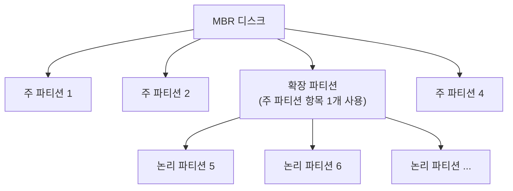
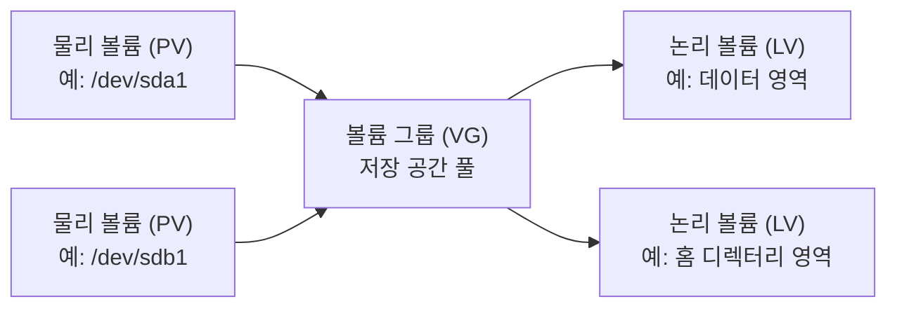
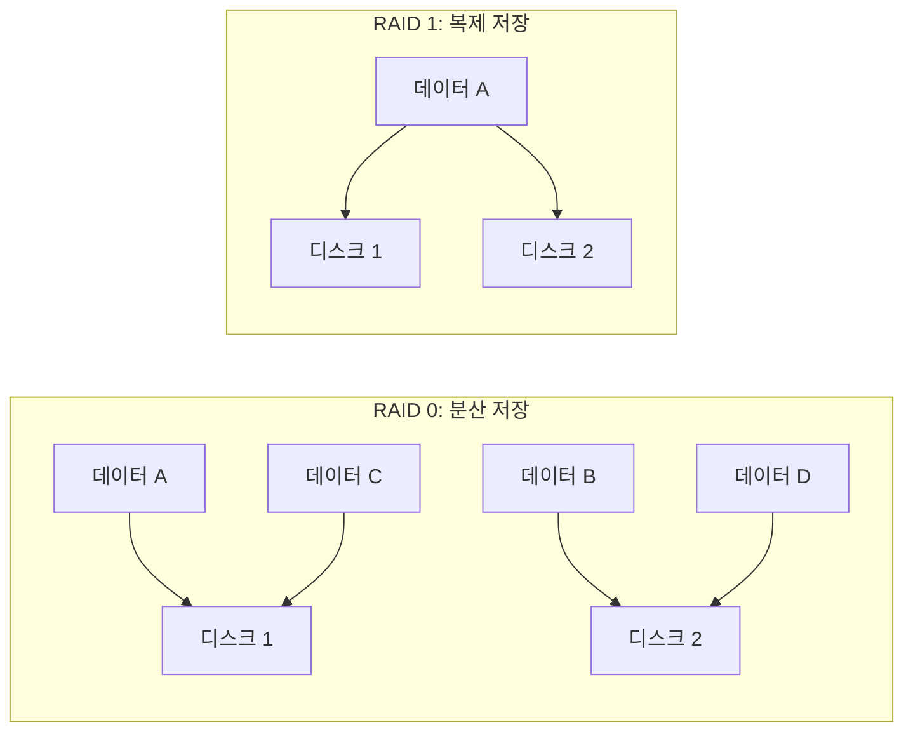

# 파티션과 저장 공간 관리

## 1. 파티션의 개념과 종류

파티션은 하나의 물리 디스크를 여러 개의 논리적인 영역으로 나눈 것이다. 각 파티션은 서로 다른 파일 시스템을 사용하거나, 운영체제와 데이터 영역을 분리하는 데 활용할 수 있다.

### 파티션을 나누는 이유

- 운영체제와 사용자 데이터를 분리해 관리하기 쉽다.

- 특정 파티션에 문제가 생겼을 때 다른 파티션에 미치는 영향을 줄일 수 있다.

- 필요한 파티션만 별도로 백업하거나 포맷할 수 있다.

- 파티션마다 파일 시스템을 다르게 구성할 수 있다.

> 파티션을 나눈다고 부팅 시간이 반드시 단축되는 것은 아니다. `/proc/partitions`는 커널이 인식한 파티션 정보를 보여 주는 가상 파일이며, 파티션 정보를 저장하는 일반 파일이 아니다.

### MBR 파티션의 종류

MBR 방식에서는 디스크의 파티션 테이블에 주 파티션 항목을 최대 4개까지 둘 수 있다. 4개보다 많은 파티션이 필요하면 주 파티션 항목 하나를 확장 파티션으로 사용하고, 그 안에 논리 파티션을 만든다.

| 종류 | 설명 |
|---|---|
| 주 파티션 | 운영체제나 데이터를 저장하는 기본 파티션. MBR에서는 확장 파티션을 포함해 최대 4개의 항목을 만들 수 있다. |
| 확장 파티션 | MBR에서 논리 파티션을 담기 위한 컨테이너. 주 파티션 항목 중 하나를 차지하며, 디스크당 하나만 만들 수 있다. |
| 논리 파티션 | 확장 파티션 안에 만드는 파티션. MBR 디스크에서는 보통 5번부터 번호가 매겨진다. |
| 스왑 영역 | 메모리가 부족할 때 보조 공간으로 활용하는 영역. 파티션 또는 스왑 파일로 만들 수 있으며, 스왑 파티션이 항상 필수인 것은 아니다. |

> 위의 4개 제한과 확장·논리 파티션 구조는 **MBR 파티션 방식**에 관한 설명이다. GPT는 이와 다른 파티션 방식이며, 일반적으로 확장 파티션을 사용하지 않는다.

## 2. 디스크 장치명과 파티션 이름

리눅스에서는 디스크와 파티션을 `/dev` 아래의 장치 파일로 나타낸다. 장치 이름은 하드웨어 종류와 시스템 구성에 따라 달라질 수 있다.

| 장치 종류 | 장치 파일 예시 | 설명 |
|---|---|---|
| SCSI/SATA/USB 디스크 | `/dev/sda`, `/dev/sdb` | 첫 번째 디스크가 항상 같은 하드웨어 종류라는 뜻은 아니다. 인식 순서 등에 따라 이름이 달라질 수 있다. |
| SCSI/SATA/USB 디스크의 파티션 | `/dev/sda1`, `/dev/sda2` | 디스크 장치명 뒤에 파티션 번호를 붙인다. |
| NVMe 디스크 | `/dev/nvme0n1` | NVMe 장치와 네임스페이스를 나타낸다. |
| NVMe 디스크의 파티션 | `/dev/nvme0n1p1` | 장치명 뒤에 `p`와 파티션 번호를 붙인다. |
| CD-ROM | `/dev/sr0` | 광학 드라이브의 장치명 예시. `/dev/scd0`도 사용된 적이 있다. |
| 플로피 디스크 | `/dev/fd0`, `/dev/fd1` | 첫 번째·두 번째 플로피 드라이브의 전통적인 장치명. |
| 구형 IDE 디스크 | `/dev/hda`, `/dev/hdb`, `/dev/hdc`, `/dev/hdd` | 각각 첫 번째·두 번째 IDE 채널의 Master/Slave 장치에 해당하는 전통적인 이름. |

> IDE 이름은 오래된 장치 명명 방식이다. 현재 시스템에서 디스크를 확인할 때는 `lsblk` 명령을 사용하는 것이 편리하다.

## 3. 데이터 저장 단위

아래 표는 국제단위계(SI)의 **십진수 기준**이다. 소문자 `b`는 bit, 대문자 `B`는 byte를 뜻하며, 1 byte는 8 bit다.

| 단위 | 기호 | 바이트 기준 크기 |
|---|---:|---:|
| 비트 | bit (b) | 1/8 B |
| 바이트 | byte (B) | 1 B = 8 bit |
| 킬로바이트 | kB | 10³ B = 1,000 B |
| 메가바이트 | MB | 10⁶ B = 1,000,000 B |
| 기가바이트 | GB | 10⁹ B = 1,000,000,000 B |
| 테라바이트 | TB | 10¹² B |
| 페타바이트 | PB | 10¹⁵ B |
| 엑사바이트 | EB | 10¹⁸ B |
| 제타바이트 | ZB | 10²¹ B |
| 요타바이트 | YB | 10²⁴ B |

> 운영체제나 메모리 관련 자료에서는 1 KiB = 1,024 B와 같은 2진 단위를 접할 수 있다. 이는 십진 단위인 kB와 구분되는 표기다.

## 4. 파일 시스템

파일 시스템은 운영체제가 저장 장치에 파일과 디렉터리를 저장하고 관리하는 방식이다. 일반적으로 파티션이나 논리 볼륨을 사용하려면 그 위에 파일 시스템을 만들고 적절한 위치에 마운트한다.

### 파일 시스템의 종류

| 분류 | 예시 | 특징 |
|---|---|---|
| 리눅스 기본 파일 시스템 | ext2, ext3, ext4, XFS, JFS, Btrfs | 리눅스에서 널리 사용되는 파일 시스템. ext3·ext4·XFS·JFS 등은 저널링을 지원한다. |
| 네트워크 파일 시스템 | NFS, SMB/CIFS | 네트워크를 통해 원격 시스템의 파일을 공유한다. |
| 광학 디스크 파일 시스템 | ISO 9660, UDF | CD/DVD 등 광학 매체에서 사용한다. |
| 다른 운영체제와 호환되는 파일 시스템 | FAT, VFAT, NTFS | 여러 운영체제 간 데이터 교환에 활용할 수 있다. |
| 클러스터 파일 시스템 | GFS2, OCFS2 | 여러 시스템이 공유 저장 장치에 접근하는 환경에서 사용한다. |

> 파일 시스템 분류는 사용 목적에 따른 예시이며, 분류가 서로 완전히 배타적인 것은 아니다. `swap`은 일반 파일을 저장하는 파일 시스템이 아니라 스왑 공간이다.

## 5. LVM (Logical Volume Manager)

LVM은 물리 저장 공간을 논리적으로 묶고 나누어 유연하게 관리하는 방식이다. 여러 디스크를 하나의 저장 공간처럼 구성하거나, 필요에 따라 논리 볼륨의 크기를 조정할 수 있다.

| 구성 요소 | 설명 |
|---|---|
| 물리 볼륨 (PV) | LVM에 사용할 물리 디스크 또는 파티션 |
| 볼륨 그룹 (VG) | 하나 이상의 PV를 묶어 만든 저장 공간 풀 |
| 논리 볼륨 (LV) | VG에서 필요한 크기만큼 할당해 만든 논리적 장치. 파일 시스템을 만들어 사용할 수 있다. |

> LVM은 디스크 여러 개를 한 공간처럼 관리할 수 있지만, RAID처럼 디스크 장애로부터 데이터를 자동 보호하는 기술은 아니다.

## 6. RAID (Redundant Array of Independent Disks)

RAID는 여러 물리 디스크를 조합해 하나의 논리 저장 장치처럼 사용하는 기술이다. 구성 방식에 따라 성능, 사용 가능한 용량, 장애 허용 능력이 달라진다. RAID는 백업을 대체하지 않는다.

| 레벨 | 최소 디스크 수 | 저장 방식과 특징 |
|---|---:|---|
| RAID 0 | 2개 | 데이터를 여러 디스크에 분산(스트라이핑)해 성능과 사용 용량을 높인다. 여분 데이터가 없어 디스크 하나만 고장 나도 배열 전체의 데이터에 문제가 생긴다. |
| RAID 1 | 2개 | 같은 데이터를 복제(미러링)한다. 일반적으로 디스크 한 개 분량의 용량만 사용할 수 있고, 한쪽 디스크 장애에 대응할 수 있다. |
| RAID 2 | 여러 개 | 비트 단위 스트라이핑과 해밍 코드 기반 오류 정정을 사용한다. 현대의 일반적인 시스템에서는 거의 사용하지 않는다. |
| RAID 3 | 3개 이상 | 바이트 단위 스트라이핑과 전용 패리티 디스크를 사용한다. 특수한 대용량 순차 작업에 적합하지만 일반적으로 널리 쓰이지 않는다. |
| RAID 4 | 3개 이상 | 블록 단위 스트라이핑과 전용 패리티 디스크를 사용한다. 전용 패리티 디스크가 병목이 될 수 있다. |
| RAID 5 | 3개 이상 | 블록 단위 스트라이핑과 분산 패리티를 사용한다. 디스크 한 개의 장애를 견딜 수 있으며, 용량과 장애 허용 능력의 균형을 제공한다. |
| RAID 6 | 4개 이상 | 분산 패리티를 두 개 저장한다. 디스크 두 개의 장애까지 견딜 수 있지만, 패리티 계산으로 쓰기 성능에 부담이 생길 수 있다. |
| RAID 0+1 | 4개 이상 | 스트라이핑한 RAID 0 두 세트를 미러링한다. |
| RAID 1+0 (RAID 10) | 4개 이상 | 미러링한 쌍들을 스트라이핑한다. 성능과 장애 허용 능력이 좋지만, 일반적으로 전체 용량의 절반을 사용한다. |

## 7. 파티션 관리: `fdisk`

`fdisk`는 디스크의 파티션 테이블을 확인하거나 파티션을 생성·변경·삭제하는 도구다. 잘못된 디스크를 선택하거나 변경 내용을 저장하면 데이터가 손실될 수 있으므로, 실제 디스크에 적용하기 전에 대상 장치를 반드시 확인한다.

### 자주 사용하는 명령

| 명령 | 기능 |
|---|---|
| `sudo fdisk -l` | 디스크와 파티션 정보 목록을 확인한다. |
| `sudo fdisk /dev/sdb` | 지정한 디스크의 대화형 파티션 관리 화면을 연다. |
| `p` | 현재 파티션 테이블을 출력한다. |
| `n` | 새 파티션을 만든다. |
| `t` | 파티션 유형을 변경한다. |
| `l` | 파티션 유형 코드 목록을 확인한다. |
| `a` | 부팅 가능 플래그를 전환한다. 지원 여부와 의미는 파티션 방식에 따라 다를 수 있다. |
| `w` | 변경 사항을 디스크에 기록하고 종료한다. |
| `q` | 변경 사항을 기록하지 않고 종료한다. |

> 파티션을 실제로 만들거나 변경하려면 대화형 화면에서 추가 질문에 답해야 한다. 연습은 가상 머신의 테스트용 디스크에서 진행하고, `w`를 선택하기 전에 대상 디스크와 변경 내용을 다시 확인한다.
